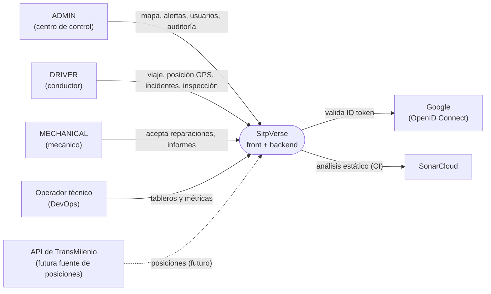
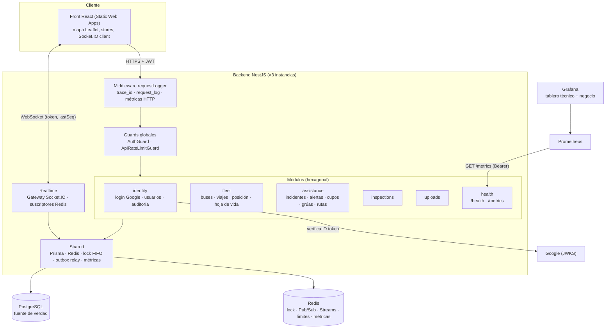
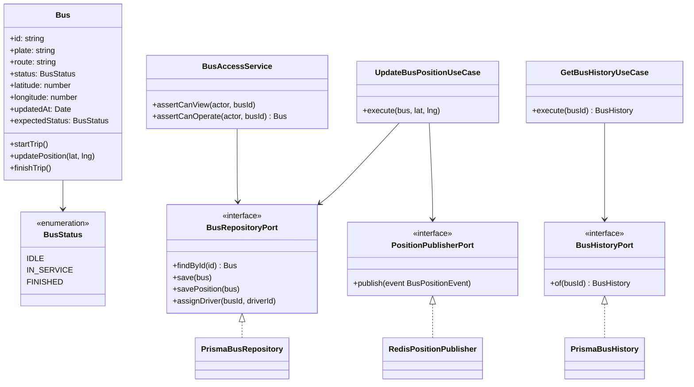
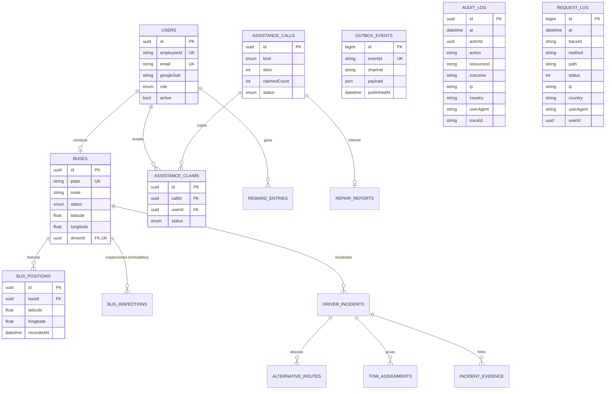
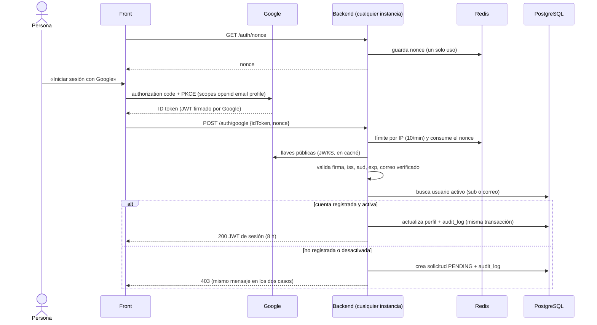
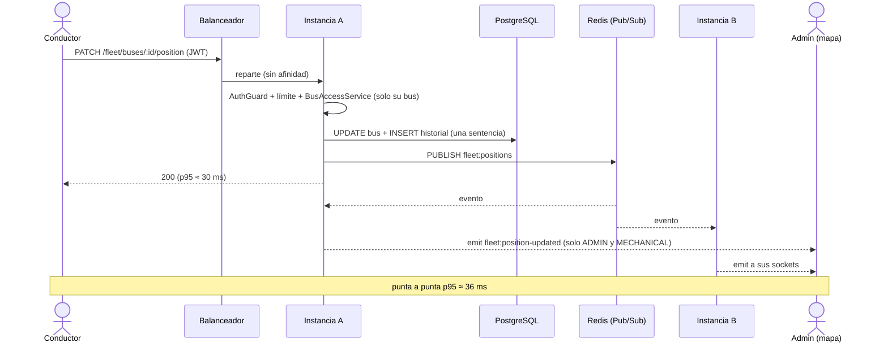
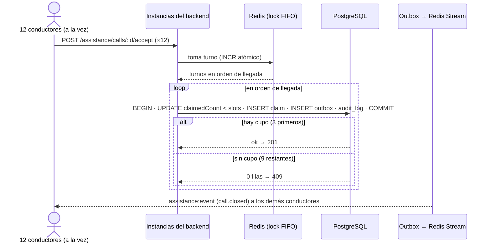
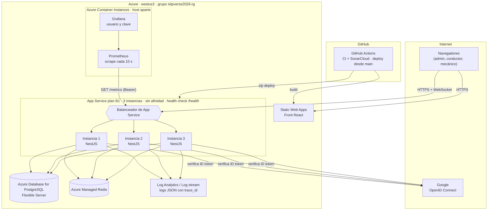
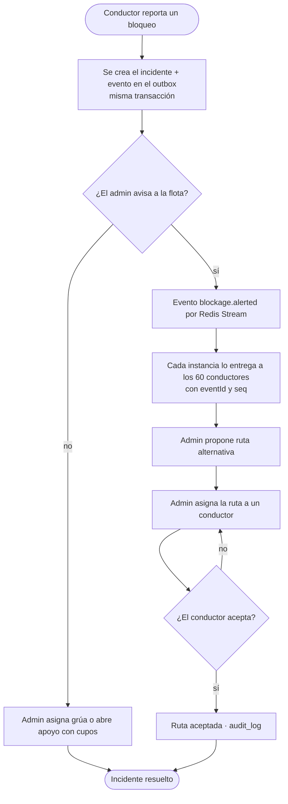

# SitpVerse · Documento de arquitectura (Sprint 2)

Team Spiderverse · Arquitecturas de Software 2026-2 · Escuela Colombiana de Ingeniería Julio Garavito

Los diagramas están en [Mermaid](https://mermaid.js.org/): GitHub los dibuja directamente en este archivo. Para el documento
impreso hay una imagen de cada uno en [`docs/diagramas/`](diagramas/) (PNG a doble resolución y SVG, fondo blanco); se regeneran con
`node scripts/evidence/render-diagrams.js`.

| Diagrama | Imagen |
|---|---|
| 4.1 Contexto | `diagramas/01-contexto.png` |
| 4.2 Componentes | `diagramas/02-componentes.png` |
| 4.3 Clases | `diagramas/03-clases.png` |
| 4.4 Entidad-relación | `diagramas/04-entidad-relacion.png` |
| 4.5 Secuencia · inicio de sesión | `diagramas/05-secuencia-login-google.png` |
| 4.6 Secuencia · posición GPS | `diagramas/06-secuencia-posicion-gps.png` |
| 4.7 Secuencia · cupos concurrentes | `diagramas/07-secuencia-cupos-concurrentes.png` |
| 4.8 Despliegue (obligatorio) | `diagramas/08-despliegue.png` |
| 4.9 Actividades | `diagramas/09-actividades-bloqueo.png` |

## Índice

1. Drivers arquitectónicos
2. Atributos de calidad: escenarios y tácticas
3. Decisiones de diseño (ADR)
4. Diagramas UML (8): contexto, componentes, clases, entidad-relación, secuencia (3), despliegue, actividades

---

## 1. Drivers arquitectónicos

### 1.1 Requerimientos funcionales relevantes

SitpVerse es el centro de operación de una flota de buses de TransMilenio con tres roles: **ADMIN** (centro de control),
**DRIVER** (conductor) y **MECHANICAL** (mecánico).

| Área | Qué hace | Por qué pesa en la arquitectura |
|---|---|---|
| Acceso | Inicio de sesión con Google, solicitudes de acceso aprobadas por un admin, gestión de usuarios y roles | Seguridad: identidad externa, rol vigente en cada petición |
| Flota en vivo | Viajes, posición GPS cada 3 s por bus, mapa en tiempo real, «Sin señal» | Tiempo real, volumen (20 peticiones/s), latencia |
| Asistencia | Incidentes, bloqueos con alerta a toda la flota, alertas de apoyo con **cupos**, reparaciones, grúas, rutas alternativas, puntos | **Concurrencia**: 12 aceptan 3 cupos a la vez; no se pierden alertas |
| Inspecciones | Inspección con fotos antes de salir; hoja de vida del bus | Trazabilidad e inmutabilidad |
| Operación | Auditoría, registro de peticiones, tableros | Observabilidad |

### 1.2 Atributos de calidad (prioridad)

1. **Rendimiento / latencia en tiempo real**: la posición llega al mapa en menos de 500 ms (p95).
2. **Disponibilidad y escalabilidad**: el backend escala horizontalmente; la caída de una instancia no se nota.
3. **Seguridad**: autenticación externa, autorización por rol y por recurso, trazabilidad inmutable.
4. **Observabilidad**: ver el estado y rastrear una falla hasta su petición.
5. **Mantenibilidad**: inspección continua del código y reglas de arquitectura ejecutables.

### 1.3 Restricciones tecnológicas

- **Balanceador de carga** delante del backend (App Service lo trae): el sistema no es un servidor único.
- Backend **NestJS** (Node.js 22) y front **React + Vite**; base **PostgreSQL**; **Redis** para coordinación y mensajería.
- Despliegue en **Azure** (App Service, Database for PostgreSQL, Managed Redis, Static Web Apps).
- Identidad con **Google (OpenID Connect)**: no se guardan contraseñas.
- Análisis estático con **SonarCloud** en el pipeline de **GitHub Actions**.

### 1.4 Supuestos arquitectónicos

- Hora pico: **60 buses** en servicio y **140 usuarios** viendo el mapa (200 clientes conectados).
- Cada bus manda su posición cada **3 s**; perder una posición es aceptable (la siguiente la reemplaza), perder una alerta no.
- La fuente de posiciones hoy es el GPS del conductor por HTTP; mañana puede ser la API real de TransMilenio: debe tocar
  **un solo adapter**.
- El número de empleado y el rol los define un administrador; Google solo aporta la identidad.
- Un solo administrador de datos: una sola base PostgreSQL y un solo Redis compartidos por todas las instancias.

---

## 2. Atributos de calidad: escenarios y tácticas

El detalle de cada escenario (estímulo, artefacto, respuesta y medida) está en *«SitpVerse: Escenarios de calidad del
Sprint 2»*. Esta tabla muestra la **consistencia con la arquitectura**: qué componente resuelve cada escenario.

| Escenario | Táctica | Componentes que la implementan |
|---|---|---|
| **ESC-DISP-01** Disponibilidad (escalabilidad + tolerancia a fallos) | Redundancia activa (3 réplicas), detección de fallas, reintento, reconexión y recuperación de eventos, estado compartido fuera de la instancia | App Service ×3 + balanceador sin afinidad; `GET /health`; reintento en el front; Socket.IO solo WebSocket + `lastSeq`; Redis; outbox |
| **ESC-SEG-01** Autenticación | Resistir ataques: autenticar con proveedor externo, limitar el acceso | Google OIDC; `GoogleIdTokenVerifier`; nonce de un uso (Redis); `AuthGuard` global; límite por IP en `/auth/*` |
| **ESC-SEG-02** Autorización | Resistir ataques: autorizar actores, limitar y revocar el acceso; falla cerrado | `@Roles`, `AuthGuard`, rol leído de PostgreSQL en cada petición, `BusAccessService`, salas del Gateway por rol; límite por usuario en la API |
| **ESC-SEG-03** Trazabilidad | Recuperar (registro de auditoría) y detectar | `request_log` (todas las peticiones), `audit_log` (acciones críticas, misma transacción), triggers de solo inserción, inspecciones inmutables, hoja de vida del bus |
| **ESC-MANT-01** Mantenibilidad | Inspección continua, coherencia modular, aislar dependencias externas | GitHub Actions, SonarCloud, `architecture.spec.ts`, puertos y adaptadores (hexagonal) |
| **ESC-REND-01** Rendimiento / latencia | Procesamiento asíncrono, mensajería en memoria, sincronización con lock y restricciones en la base, camino ligero para lo efímero | Redis Pub/Sub (posiciones), outbox + Redis Streams (alertas), lock FIFO en Redis, `UPDATE` condicional, índice `(busId, recordedAt)` |
| **ESC-OBS-01** Observabilidad | Monitorear, registrar, correlacionar | `trace_id` + `X-Trace-Id`, logs JSON, `GET /metrics` (todas las instancias), Prometheus, Grafana (2 tableros) |

---

## 3. Decisiones de diseño (ADR)

Cada ADR: **contexto → decisión → consecuencias**.

### ADR-01 · Monolito modular con arquitectura hexagonal

- **Contexto.** Equipo de tres personas, dominio acotado, cuatro meses. Los microservicios sumarían costo operativo sin
  beneficio; pero el código debe poder separarse y cambiar de proveedor (identidad, GPS) sin reescribir.
- **Decisión.** Un solo backend NestJS dividido en **módulos** (`identity`, `fleet`, `assistance`, `inspections`,
  `uploads`, `health`) y cada módulo en capas **domain → application → adapters/infrastructure** (puertos y adaptadores).
  Un módulo solo se importa por su `public.ts`. Las reglas son **pruebas** (`architecture.spec.ts`): `domain/` y
  `application/` no importan Prisma, Redis ni Socket.io; toda ruta declara `@Roles` o `@Public`.
- **Consecuencias.** (+) Cambiar Google por otro proveedor o conectar la API de TransMilenio toca un adapter. (+) El
  monolito escala horizontalmente (ADR-02). (−) Todos los módulos se despliegan juntos.

### ADR-02 · Backend sin estado, escalado horizontal tras el balanceador de App Service

- **Contexto.** El enunciado exige escalar horizontalmente con un balanceador y no centralizar en un servidor.
- **Decisión.** 3 instancias del backend en App Service, **sin afinidad de sesión (ARR affinity desactivada)**. Nada
  importante vive en la instancia: sesión = JWT, cupos = lock en Redis + `UPDATE` condicional, eventos = Redis, datos =
  PostgreSQL. Health check `GET /health` (PostgreSQL + Redis).
- **Consecuencias.** (+) Cualquier instancia atiende cualquier petición; si una cae, el balanceador la retira y se
  reintenta en otra. (−) Cada instancia abre su pool de conexiones: se limita en `DATABASE_URL`
  (`connection_limit=10`). (−) Las conexiones WebSocket sí son de una instancia: se resuelve con ADR-05.

### ADR-03 · PostgreSQL como fuente de verdad y Redis para lo efímero y la coordinación

- **Contexto.** Hay datos que no se pueden perder (alertas, cupos, auditoría) y datos de alto volumen y corta vida
  (posiciones).
- **Decisión.** PostgreSQL guarda todo lo que importa y decide los conflictos (restricciones únicas, `UPDATE`
  condicional, triggers). Redis se usa para: lock FIFO, Pub/Sub de posiciones, Streams de alertas, nonces del login,
  límites de peticiones y las métricas por instancia.
- **Consecuencias.** (+) Si Redis pierde datos, no se pierde ningún dato de negocio. (−) Redis es una dependencia
  crítica: `/health` lo comprueba y el límite de peticiones se omite si cae.

### ADR-04 · Outbox transaccional + Redis Streams para las alertas

- **Contexto.** «0 alertas perdidas»: si se guardara el cambio y luego se publicara el evento, una caída entre las dos
  cosas perdería la alerta (o publicaría una que hizo rollback).
- **Decisión.** El evento se escribe en la tabla `outbox_events` **en la misma transacción** que el cambio. Un *relay*
  (cualquier instancia) lo publica en un **Redis Stream** y lo marca como publicado. La entrega es *at-least-once*;
  cada evento lleva `eventId` (el cliente descarta duplicados) y `seq` creciente.
- **Consecuencias.** (+) Lo que la instancia caída no alcanzó a publicar lo publica otra. (−) Latencia extra de decenas
  de ms y eventos duplicados posibles (por eso `eventId`).

### ADR-05 · WebSocket sin afinidad y reanudación con `lastSeq`

- **Contexto.** Al caer una instancia, sus sockets deben volver sin perder alertas.
- **Decisión.** Socket.IO usa **solo el transporte `websocket`** (el *long polling* exige que todas las peticiones de una
  conexión caigan en la misma instancia). El cliente manda el último `seq` visto en **cada** reconexión
  (`auth` es una función); al conectarse por primera vez el servidor le dice el `seq` actual. El servidor reenvía desde el
  outbox lo que corresponda a su audiencia.
- **Consecuencias.** (+) Reconexión a cualquier instancia en menos de 2 s medidos. (−) Sin *fallback* a polling en
  redes que bloquean WebSocket.

### ADR-06 · Dos caminos de entrega: posiciones efímeras y alertas durables

- **Contexto.** Una posición se reemplaza a los 3 s; una alerta no.
- **Decisión.** Las **posiciones** no pasan por el outbox: se guardan con una sola sentencia SQL
  (`UPDATE` del bus + `INSERT` del historial, con `synchronous_commit = off`) y se publican por **Redis Pub/Sub**. Las
  **alertas** van por ADR-04.
- **Consecuencias.** (+) Posición de punta a punta p95 de decenas de ms. (−) Una caída del servidor de base de datos
  puede perder las últimas décimas de segundo de posiciones; es aceptable por diseño.

### ADR-07 · Cupos: lock FIFO en Redis + decisión final en PostgreSQL

- **Contexto.** 12 conductores aceptan a la vez una alerta de 3 cupos: exactamente 3 ganan, en orden de llegada.
- **Decisión.** Un **ticket lock FIFO** sobre Redis (`INCR` atómico fija el orden entre todas las instancias; una
  sección crítica que muere no bloquea la cola) y, dentro, un `UPDATE` condicional más una restricción única en
  PostgreSQL. El lock **ordena**; la base **decide**.
- **Consecuencias.** (+) 0 sobreasignaciones aunque el lock expire. (−) Un salto más; se mide con `waited_ms` y
  `held_ms` (tablero técnico).

### ADR-08 · Identidad con Google (OpenID Connect); la autorización la decide SitpVerseBack

- **Contexto.** Comentario del profesor: «con un proveedor de identidad externo, nada de logins caseros».
- **Decisión.** El front obtiene un ID token de Google; el backend valida firma (JWKS), emisor, audiencia, vencimiento,
  correo verificado y un `nonce` de un solo uso, y emite un **JWT de sesión de 8 horas** (un turno). El **rol** no viene de
  Google: lo asigna un administrador y se **lee de PostgreSQL en cada petición**. Una cuenta no registrada queda como
  **solicitud pendiente** (`PENDING_APPROVAL`) que un administrador aprueba o rechaza. Cuenta no registrada y desactivada
  reciben el mismo 403.
- **Consecuencias.** (+) 0 contraseñas guardadas; el cambio de rol o la desactivación aplican en la siguiente petición y
  la app cambia de pantallas sin recargar. (−) Dependemos de Google para entrar.

### ADR-09 · Trazabilidad: dos registros de solo inserción, con el cambio en la misma transacción

- **Contexto.** Comentario del profesor: garantizar en **todas** las peticiones hora, IP, usuario, navegador y país.
- **Decisión.** `request_log` guarda **todas** las peticiones (también las rechazadas); `audit_log` guarda las acciones
  críticas y se inserta **dentro de la transacción** del cambio (`@Audited` + contexto de la petición). Triggers de
  PostgreSQL rechazan `UPDATE` y `DELETE` (también para el usuario de la aplicación); solo se permite borrar por
  retención (7 días `request_log`, 365 días `audit_log`). Las inspecciones también son inmutables.
- **Consecuencias.** (+) Imposible un cambio crítico sin su registro. (−) `request_log` crece: se escribe por lotes y se
  purga con una política de retención.

### ADR-10 · Observabilidad: métricas por instancia agregadas por la propia API

- **Contexto.** Prometheus no puede elegir a qué instancia le pregunta detrás de un balanceador.
- **Decisión.** Cada instancia publica sus métricas en Redis cada 4 s y `GET /metrics` responde las de **todas las
  instancias vivas** (etiqueta `instance`) más las del sistema (KPIs de negocio, outbox, buses sin señal, estado de
  PostgreSQL y Redis). Una instancia que deja de publicar sale en 12 s. Prometheus y Grafana corren en un **host aparte**
  (Azure Container Instances). `/metrics` exige token en producción.
- **Consecuencias.** (+) Un solo objetivo de Prometheus ve todo el clúster; la caída se ve antes que el health check de
  Azure. (−) Las métricas pasan por Redis.

### ADR-11 · Límite de peticiones en dos niveles

- **Decisión.** Por **IP** en el inicio de sesión (10/min: protege el costo de verificar tokens) y por **usuario** en el
  resto de la API (600/min; 20/min para subir fotos), con contadores en Redis compartidos entre instancias y respuesta
  `429` con `Retry-After`. Si Redis cae, el límite se omite.
- **Consecuencias.** (+) Un cliente con errores o abusivo no degrada a los demás. (−) Las pruebas de carga con pocos
  usuarios necesitan subir el límite (`RATE_LIMIT_PER_MINUTE`).

### ADR-12 · Calidad de código y despliegue controlados por el pipeline

- **Decisión.** Cada PR corre compilación, pruebas unitarias y de arquitectura con cobertura, **pruebas de integración
  contra PostgreSQL y Redis reales** y SonarCloud (Quality Gate: cobertura nueva ≥ 80 % en el back y ≥ 40 % en el front).
  El despliegue a Azure solo corre desde `main`.
- **Consecuencias.** (+) Nada llega a producción sin pasar el gate. (−) Pipeline de ~3,5 min.

---

## 4. Diagramas UML

### 4.1 Diagrama de contexto

### 4.2 Diagrama de componentes

### 4.3 Diagrama de clases (dominio de flota y puertos)

### 4.4 Diagrama entidad-relación

`audit_log`, `request_log`, `outbox_events` y `bus_inspections` no tienen relaciones de borrado en cascada: son de solo
inserción (triggers).

### 4.5 Diagrama de secuencia · inicio de sesión con Google (ESC-SEG-01)

### 4.6 Diagrama de secuencia · posición GPS en tiempo real (ESC-REND-01)

### 4.7 Diagrama de secuencia · 12 conductores aceptan 3 cupos (ESC-REND-01)

### 4.8 Diagrama de despliegue (obligatorio)

**Distribución física**: el front (Static Web Apps), el backend (3 instancias), la base de datos (PostgreSQL), el
Redis (lock, Streams y Pub/Sub) y el monitoreo (Prometheus y Grafana) corren en **servicios distintos**: no hay un
despliegue centralizado en un solo servidor.

### 4.9 Diagrama de actividades · alerta de bloqueo (opcional)

